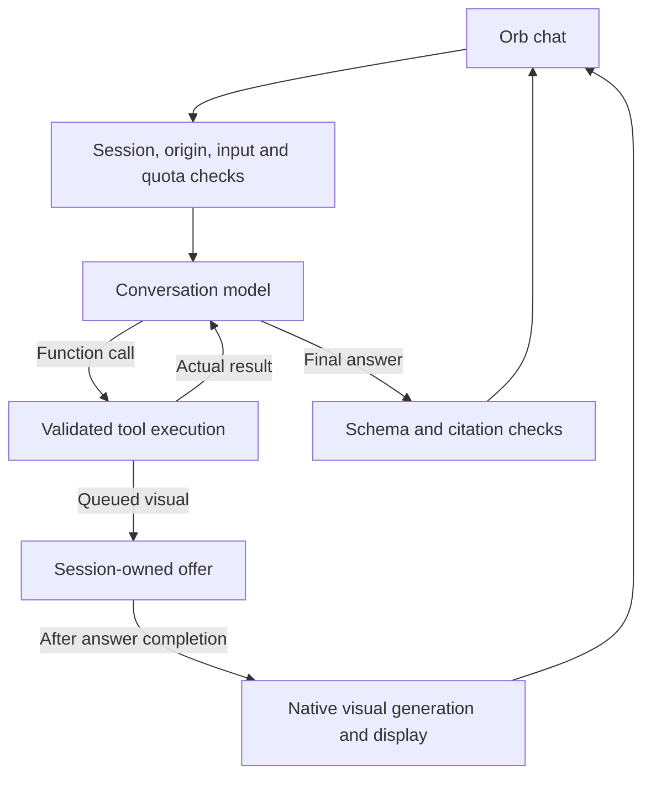

# Metabloom conversation toolset

Ordinary chat selects tools through the selected OpenAI, Claude or DeepSeek provider adapter. It can answer directly, call a tool, inspect the result, and continue. A current-news follow-up no longer depends on Jev choosing the Deep Research scene or a keyword classifier selecting a separate writer. Search still uses the OpenAI web-search backend.

The [UX invariants](metabloom-ux-invariants.md) are enforced by a shared host/browser lifecycle. Ordinary search now streams its actual search and source activity with visible handoffs, elapsed time and explicit cancellation.

## Runtime map



| Tool | Execution | Result boundary |
| --- | --- | --- |
| `search_web(query)` | A focused Responses request uses built-in `web_search`, with up to three web calls. The existing research extractor validates provider URL annotations. | Complete cited passages, at most eight canonical sources, and the server date. No structured-news formatter is required. |
| `calculate(tokens)` | Existing reverse-Polish evaluator, numeric constants and six arithmetic operators. | A finite bounded number or a failure. No JavaScript evaluation. |
| `get_current_time()` | Server clock formatted in the validated client timezone. | UTC timestamp, timezone and local date/time. |
| `create_visual(kind, brief)` | Claims the request, checks visual quota, and stores a session-owned offer. The browser uses the existing generation endpoint and strict renderer. | `queued`, with display explicitly `unconfirmed`. A queued offer is not evidence of generation or mounting. |
| `get_orb_state()` | Reads the strict browser snapshot captured at request start. | Presentation settings and the latest transient expression receipt. Browser report only, not proof of human perception. |
| `express_orb(emote)` | Queues one existing semantic gesture or authored chain after the answer validates. | `queued`, with display `unconfirmed`. Explicit choice takes priority over response Jev; the next turn reports playback, suppression or interruption. |

The visual formats remain table, bar chart, line chart, pie chart, flowchart and calculator. The tool is omitted when native visuals, UI tools or Redis are unavailable, or the request explicitly excludes visuals. Search is omitted for source-limited requests. There are no shell, arbitrary-code, repository-write, deployment, email or private-account tools.

## Ownership and limits

- Authentication, same-origin validation, bounded input and shared chat quota precede all paid work. Client-supplied tool names never execute directly.
- Four serial function calls and five conversation-model responses per turn. At most two web searches, one visual offer and one accepted expression. The final model step has no tools.
- One absolute 75-second server deadline and 90-second browser deadline. Tool activity cannot renew them. Disconnect aborts downstream requests.
- Provider JSON is limited to 128 KiB per response; ordinary search uses bounded SSE with 128 KiB per event and 512 KiB per stream. Replay input is limited to 96,000 UTF-8 bytes. Search keeps complete cited passages, at most 12,000 characters per result, with one stable eight-source namespace per turn.
- Unknown tools, duplicate call IDs, parallel calls and malformed envelopes fail closed. Known tool failures return bounded failure results so the model can explain or recover within the remaining budget. Visual storage failure never becomes a successful offer.
- Responses use `store: false`. Encrypted reasoning and tool outputs are replayed privately to the model for continuation. The browser receives only validated activity, sources, answer text and an optional visual offer. Logs contain safe tool names, outcomes, token counts and request references, not raw queries, arguments, source evidence or reasoning.
- Final text stays private until its schema and citation IDs validate. A successful search requires citations in the final answer. Citation validation proves the ID belongs to this turn; it does not prove semantic support or guarantee news coverage. Source text remains untrusted data.

## Transport and compatibility

The current client negotiates `X-Metabloom-Toolset: 2` for ordinary turns without an attached artifact or saved research reference. GET metadata advertises `toolset: 2`. Version 1 remains supported without the new progress records. Jev chooses the input gesture and optional Under the Hood scene, plus the final gesture when the model has not explicitly chosen one. It does not select or execute ordinary-chat tools.

The additive `X-Metabloom-Expressions: 1` header and validated `orbContext` enable the [expression loop](metabloom-expression-loop.md). Its metadata is sent after `text_complete`, before the final emote and `done`. The decoder releases the expression only after validating `done`. Clients without this capability keep their existing event vocabulary. `METABLOOM_EXPRESSIONS_ENABLED=false` disables the tools and metadata. The user's preference can remove `express_orb` while keeping the snapshot tool available.

New bounded NDJSON records precede the first answer segment:

```jsonl
{"type":"agent_status","state":"working"}
{"type":"tool_activity","name":"search_web","callId":"call_1","state":"running"}
{"type":"tool_progress","name":"search_web","callId":"call_1","sequence":1,"summary":"Reading: example.com"}
{"type":"tool_activity","name":"search_web","callId":"call_1","state":"complete"}
{"type":"agent_status","state":"reviewing"}
{"type":"agent_status","state":"validating"}
{"type":"tool_sources","sources":[{"id":1,"title":"Announcement","url":"https://example.com/news"}]}
```

`failed` is the other terminal activity state. The decoder requires matched serial activity, a completed search before source metadata, and sources before text. Version 2 also requires the tool lifecycle's handoff and validation stages before committing text. Source IDs use the existing clickable inline `[n]` citation renderer. There is no Deep Research scene requirement for these events. A `visual_offer` retains its existing position after validated text and the final gesture, before `done`.

Explicit Deep Research mode keeps the longer report/brief pipeline. Selected saved research and artifact follow-ups keep their existing owner-checked reuse, fresh-research and conversion paths. Cached clients without the header retain the previous writer and forced visual continuation contract. New ordinary visual requests are no longer intercepted by the browser's legacy classifier.

## Code and verification

| Responsibility | File |
| --- | --- |
| Negotiation, authorization, deadlines and stream | `api/metabloom.js` |
| Model loop and tool handlers | `server/metabloomAgent.js` |
| Expression vocabulary and bounded observations | `src/components/metabloomExpressionProtocol.js` |
| Activity vocabulary and decoder | `src/components/metabloomAgentTools.js`, `metabloomEmoteProtocol.js` |
| Client, status and citations | `metabloomApiClient.js`, `OrbSection.js` |
| Visual handoff | `MetabloomVisuals.js`, `server/metabloomVisualStore.js`, `api/metabloom-visual.js` |

`scripts/metabloom-agent.test.cjs` tests tool selection transport, argument rejection, replay, search extraction, citation merging, numerical failures, clock, quotas, budgets, cancellation and stream ordering. `scripts/metabloom-agent-api.test.cjs` exercises the authenticated route and the missing-news regression with fictional provider responses. UI tests exercise ordinary status, source attachment and suppression of duplicate visual routing. The mobile-workspace and thread browser suites use the new default agent stream; the UI-browser suite explicitly preserves legacy continuation coverage.

Provider fixtures are not proof of live model behavior or production news coverage. No new credential is required beyond the existing OpenAI and quota/visual storage configuration. The separate Deep Research summary-formatting incident is not fixed by this change.

API references: [Function calling](https://developers.openai.com/api/docs/guides/function-calling) and [Web search](https://developers.openai.com/api/docs/guides/tools-web-search).
