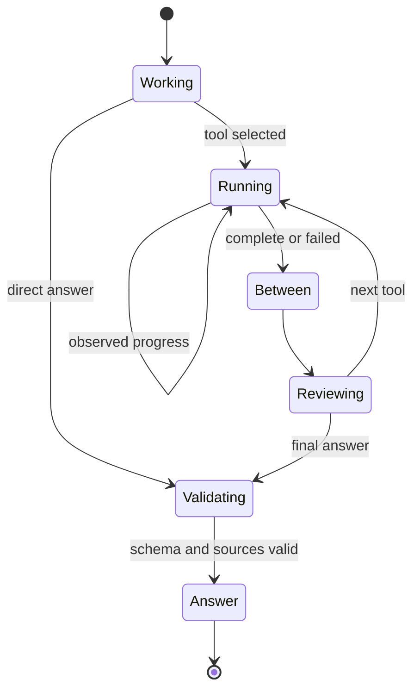

# Metabloom UX invariants

These are execution and rendering requirements. Prompts may describe them, but prompts are not their enforcement boundary.

| Invariant | Structural enforcement | Regression evidence |
| --- | --- | --- |
| Dispatched work is visible before it starts. | The shared lifecycle must accept `working` before a tool can enter `running`. The host awaits its progress write before invoking the tool. | API test asserts status exists before the provider request starts. |
| Live updates describe observed work. | Ordinary web search uses the same bounded SSE reader as Deep Research. Only recognized public search/page events produce summaries. Reasoning and draft source text cannot produce progress. | An open provider stream must deliver a search query and source check before the completed response is released. |
| Handoffs remain visible until there is an answer. | Tool completion enters `between`, then `reviewing`; final output enters `validating`. The v2 decoder rejects text while a tool is active or before the final validation phase. | Lifecycle and transport tests reject premature text, duplicate stages and fabricated completions. |
| Silence is not fabricated advancement. | The UI shows actual elapsed time. After 12 seconds without an event it says “Waiting for the next update.” There is no estimated percentage or timer-generated milestone. | Fake-clock tests check the waiting message, elapsed time and the unchanged absolute deadline. |
| Stop, replacement and failure end the current work. | Each request owns its abort signal, lifecycle and UI callbacks. Stop aborts the request, clears progress and shows “Response stopped.” Superseded callbacks cannot change the next turn. | Stop, reset, replacement, route deactivation, unmount, error and late-result tests. |
| Tool completion does not invent success. | `failed` is distinct from `complete`; a failed search cannot populate sources. A visual tool completes its queue operation, with generation/display still pending. Final source IDs and output schema validate before text is sent. | Failure, source namespace, queued-visual and citation tests. |
| Progress does not take control away from the reader. | Updates reuse the transcript's existing follow-latest guard and never focus or scroll the page. Stop stays available. The progress surface uses polite announcements, hides its per-second clock from assistive technology, and inherits reduced-motion/forced-colour styling. | Reading-position, composer-focus, timer-cleanup and accessible-status tests. |
| Work has a finite lifetime. | Existing four-call, search, size and absolute server/browser time limits remain in force. Progress cannot renew them. | Budget and deadline tests. |

## State transitions

Cancellation, disconnect or failure can terminate any active state. No more events from that request may render. Validation is a format and citation-reference check, not a claim that every factual statement has been independently proven.

`createMetabloomAgentLifecycle` in `src/components/metabloomAgentTools.js` is used by the host, stream decoder and Orb callbacks. It owns tool identity, allowed transitions, serial execution, unique call IDs and bounded consecutive progress sequences. A new tool cannot execute through the agent loop until this shared vocabulary recognizes it. Tool handlers cannot send raw model reasoning or arbitrary UI event types.

## Ordinary search transport

New clients send `X-Metabloom-Toolset: 2`. The host emits `agent_status` (`working`, `reviewing`, `validating`), the existing `tool_activity`, and bounded `tool_progress` records. The progress record contains only `type`, `name`, `callId`, `sequence` and a sanitized, at-most-200-character `summary`. Search and source activity is streamed immediately as provider events arrive; it is not reconstructed after the result completes.

For example, the user can see “Searching: current Nvidia announcement”, “Reading: example.com”, “Reviewing results” and “Checking the answer” in the ordinary transcript. Actual queries and source domains vary with observed provider activity. No Deep Research scene is required. Quiet intervals remain honestly labelled rather than implying the provider has finished another step.

The provider reader accepts at most 128 KiB per ordinary-search event and 512 KiB across that stream. Each search emits at most 23 provider progress summaries; the lifecycle permits at most 24 updates per call. Existing Deep Research retains its larger evidence budgets and current progress surface. Source icons remain part of Deep Research; ordinary progress currently displays sanitized query and domain text.

Cached toolset-v1 clients keep their previous start/complete records and receive no new event types. Selected saved research and artifact conversions retain their existing ownership and execution paths. Their existing cancellation, bounded work and native result contracts continue to apply. The new strict lifecycle covers ordinary chat's toolset, and new ordinary-chat tools must use it.

## Required checks for future tool changes

Add a test proving a progress write occurs before the external work, a test holding the provider stream open while an update reaches the UI boundary, and failure/cancellation cases that reject stale updates. Keep the shared lifecycle, decoder, host and UI vocabulary consistent. A pending tool must never produce a final answer, a fabricated milestone, or an unbounded wait. Do not weaken the state machine to make a fixture pass; update the fixture to represent the intended supported protocol.

The tests use deterministic provider fixtures. They verify transport and UX guarantees, not live search coverage, provider latency, or model tool-selection quality. There is no guarantee of a new provider event at a fixed interval. The elapsed-time message covers that uncertainty without misrepresenting progress.
