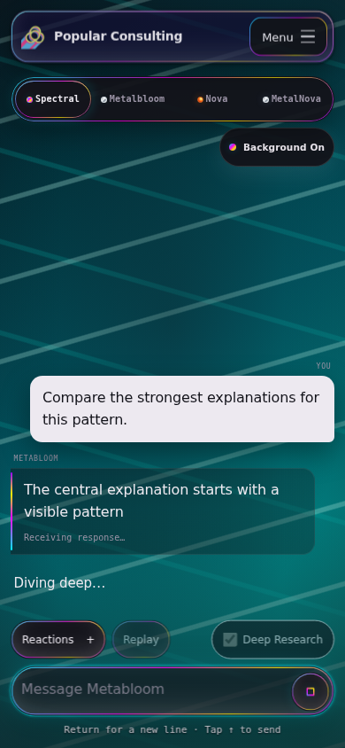

# Orb action verification

Verified the production build on 2026-10-16 using the actual `/api/metabloom`
handler, provider-stream parser, client decoder, reply session, and rendered UI.
Auth and model providers used isolated local fixtures. No live model calls ran.

Six browser cases passed with no browser runtime errors, server errors, or
unexpected provider requests:

| Case | Observed result |
| --- | --- |
| Desktop light, automatic research | Think precedes diving; text grows in the same visible bubble; held terminal completion prevents early surfacing. |
| Desktop light, under the hood | The reveal stays open through the second input-reaction chain beat and streamed text, then closes after valid completion. |
| Mobile dark, reduced motion, explicit research | The toggle fits at 390 x 844, sends the explicit mode, enables paragraphs, and uses static research cues. |
| Mobile Stop | Provider aborts; scene clears; late text is discarded; visible text remains incomplete. |
| Mobile replacement | An obsolete held terminal cannot finish or reopen the replacement's scene. |
| Mobile provider failure | Scene clears without a success cue; the incomplete prefix and error remain visible. |

The screenshot below contains only synthetic fixture text. `graphics=css`
exercises the existing fallback presentation. This evidence verifies visible
streaming, controls, and scene ownership; it does not measure live Jev intent
classification or requalify GPU shader rendering.

## Automated checks

- Full Jest run: 183 suites and 1,279 tests passed.
- Final scene/demo follow-up: 100 tests passed across the scene, activity, emote,
  and Orb integration suites, including both added demo-toggle paths.
- Backend Jev, API, provider-stream, and Orb auth checks: 57 tests passed.
- Repository ESLint, final edited-file ESLint, whitespace checks, and the final
  production build passed.

Committed regression suites cover request and wire ordering, independent
fallbacks, explicit overrides, progressive text, successful exits, fast replies,
cancellation, stale events, reduced motion, saved toggle state, and local demos.
