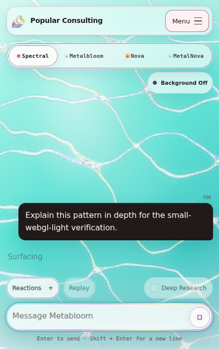
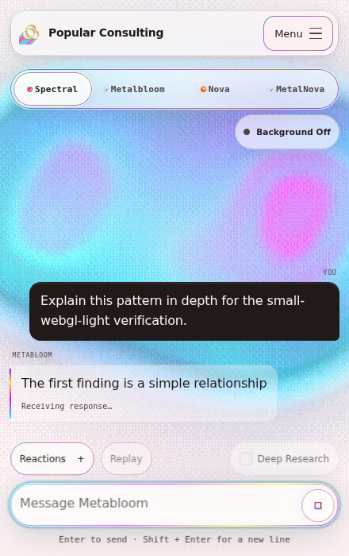
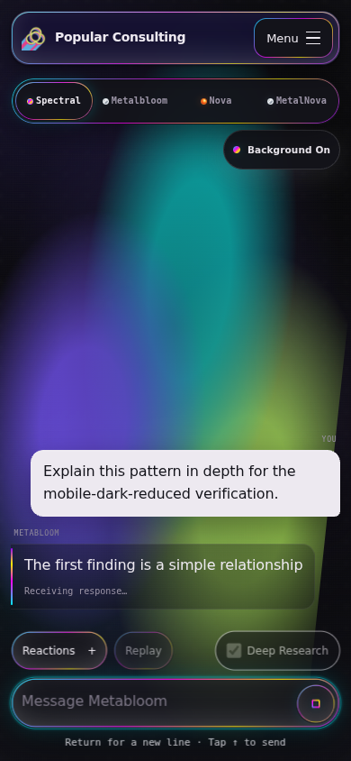

# Orb scene context and surfacing before text

This change aligns the response prompt with Jev's selected scene and keeps
research answers hidden until the Orb has finished returning. The provider
stream continues to be read and validated during the visual sequence.

The final voice refinement asks for a considerate, capable companion with light
whimsy and delight in discovery. Ordinary replies default to one to three short
sentences, leading with the useful thought. Requested depth and necessary
accuracy or safety can justify more detail. The model is prompted to respect
the user's time and emotional context and to avoid filler and forced cheer.

## Verification

| Check | Result |
| --- | --- |
| Full Jest suite | 184 suites, 1,307 tests passed |
| Focused scene, display, activity, emote, and Orb tests | 5 suites, 123 tests passed |
| API, provider stream, Jev, and Orb access tests | 61 tests passed |
| Source lint | Passed |
| Production build and private-content checks | Passed |
| Built UI in Chromium | Seven browser cases passed |

The final voice refinement was checked with 59 prompt, scene, and display tests
and 19 API tests, plus lint and a new production build. Only prompt wording
changed after the browser captures; the scene, layout, and streaming code
remained identical to the seven-case browser verification.

The browser harness served the production build and exercised the actual
`/api/metabloom` handler, provider parser, client decoder, reply session, and UI.
Authenticated-session and OpenAI/Jev transport fixtures controlled arrival and
completion separately. No external provider requests were made.

The six CSS cases covered desktop research, an already-complete fast response,
ordinary conversation and Under the Hood, mobile dark reduced-motion research,
Stop during surfacing, and replacement during a queued reveal. A seventh case
used an actual WebGL renderer at a small viewport through Chromium's SwiftShader.
These are local browser checks, not physical-device qualification.

The WebGL trace showed scene weights `[1, 0, 0]` (Metabloom, Tidal Weave,
Forward Pass) and a settled renderer when the first text appeared. The fast
completed response produced 28 observable partial prefixes after its return.
The reduced-motion response retained its static cue before text appeared.
Final emotes and visible completion followed the displayed answer. Stop and
replacement discarded unpublished text and did not play stale final reactions.

See [the compact browser results](browser-results.json) for measured timing and
renderer details. Measurements describe this run; animation scheduling varies
with the browser and device.

## Visual evidence

The first capture shows the surfacing cue while the new assistant reply is
still hidden. The second shows progressive text after the rendered return.

Mobile dark mode with reduced motion keeps the same ordering and one growing
reply bubble.

## Operational details

Automatic scene selection now waits for the existing bounded input Jev decision
before constructing the OpenAI prompt. That adds up to the existing 950 ms
decision wait before the provider starts, without another Jev call. Explicit
scene modes and legacy requests retain parallel input-reaction/provider work.

The research display holds one bounded response snapshot, preserves Unicode
graphemes and paragraph order, and reveals buffered text across animation
frames. Once caught up, subsequent provider deltas display immediately. Provider
validation and deadlines remain independent from presentation completion.

Rollback is a revert of this change. It requires no schema migration,
environment-variable change, or stored-conversation conversion.
